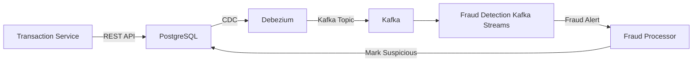
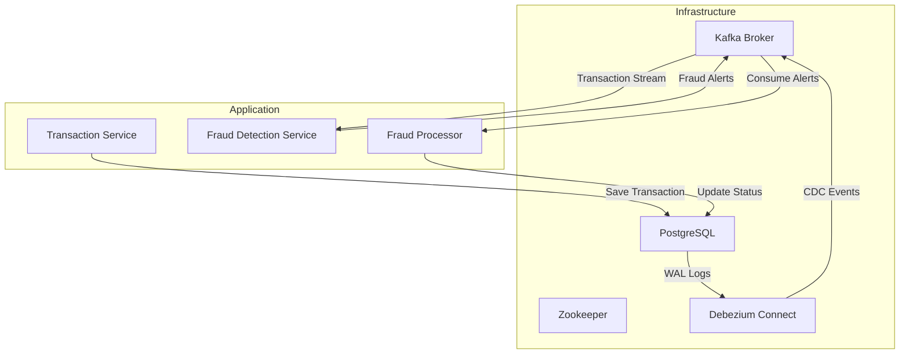

# Fraud Detection - Real-time Transaction Monitoring


### Профессиональная система для обнаружения мошеннических транзакций в реальном времени с использованием:

- Kafka Streams для обработки потоковых данных
- Debezium для CDC (Change Data Capture)
- PostgreSQL как основного хранилища данных
- Spring Boot как бэкенд-фреймворка

---
### Схема работы



---

> ### ⚠️ ВАЖНОЕ ПРИМЕЧАНИЕ ПО БЕЗОПАСНОСТИ
> **SSL/TLS ВСЕ сертификаты и ключи включены в публичный репозиторий в качестве тестового материала для обучения.  
---


## Структура проекта

```
fraud-detection/
├── src/
│   ├── main/
│   │   ├── java/com/
│   │   │   ├── config/           # Конфигурация Kafka
│   │   │   ├── controller/       # REST контроллеры
│   │   │   ├── detection/        # Главный класс приложения
│   │   │   ├── model/            # Сущности данных
│   │   │   ├── repository/       # Репозитории Spring Data
│   │   │   └── service/          # Бизнес-логика и Kafka Streams
│   │   └── resources/
│   │       ├── application.properties
│   │       └── logback-spring.xml
├── docker-compose.yml            # Docker инфраструктура
├── register-connector.sh         # Скрипт настройки Debezium
├── pom.xml                       # Maven зависимости
├── ssl/              		  # SSL сертификаты (в репозиторий)
└── README.md                     # Документация
```

---

## Технологический стек

- Java 17
- Spring Boot 3.5.0
- Apache Kafka 3.5.1
- Kafka Streams
- Debezium 2.3
- PostgreSQL 13
- Docker 20.10+
- Maven 3.8+


### Архитектура решения


---
## Требования к окружению
Минимальные системные требования

- CPU: 4 ядра
- RAM: 8 GB
- Disk: 20 GB свободного пространства
- OS: Linux/macOS/Windows (с WSL2)

### Необходимое ПО
- Docker 20.10.0+
- Docker Compose 1.29.0+
- Java JDK 17+
- Maven 3.8+
- Git 2.30+

---
## Развертывание системы
1. Клонирование репозитория

```bash
cd "$HOME"
git clone https://github.com/aladdin777/kafka_fraud_detection.git 
cd "$HOME/kafka_fraud_detection"
```

2. Запуск инфраструктуры
```bash
docker-compose up -d
```

3. Регистрация Debezium Connector
```bash
chmod +x register-connector.sh
./register-connector.sh
```

4. Сборка и запуск приложения
```bash
mvn clean package
java -jar target/fraud-detection-1.0.jar
```

5. Проверка работоспособности
```bash
curl -X POST http://localhost:8080/transactions \
  -H "Content-Type: application/json" \
  -d '{"amount": 150.0, "currency": "USD", "userId": 123}'
``` 

### Добавление настроек SSL для Spring Boot приложение:
- Все компоненты приложения уже настроены для работы с SSL

---
# Тестирование системы
## 1. Генерация тестовых транзакций
### Ограничения вызывающие статус SUSPICIOUS - не более 2 транзакций за раз и/или сумма транзакции более 1000 УЕ

### Генерируем обычную транзакцию не попадающую под ограничения
```
bash
curl -X POST http://localhost:8080/transactions -H "Content-Type: application/json" -d '{"amount": 150.0, "currency": "USD", "user_id": 1000}'
```
>Ожидаемый результат- в БД появится запись вида \br
>id операции | сумма (150) | тип валюты (USD) | статус операции (NEW)| время и дата операции | id пользователя (1000)

### Генерируем 3 транзакции попадающие под ограничение >=3
```bash
for i in {1..3}; do curl -X POST http://localhost:8080/transactions -H "Content-Type: application/json" -d "{\"amount\": $((100 * $i)), \"currency\": \"USD\", \"user_id\": 1001}" | sleep 20; done
```
```
Ожидаемый результат- транзакция попадает под правило count >= 3 и помечается в БД как "Подозрительная" (SUSPICIOUS)
```
### Генерируем транзакцию попадающую под ограничение "менее 1000"
```
curl -X POST http://localhost:8080/transactions -H "Content-Type: application/json" -d '{"amount": 1500.0, "currency": "USD", "user_id": 1002}'
Ожидаемый результат- транзакция попадает под правило amount < 1000
в БД появится запись вида
id операции | сумма (1500) | тип валюты (USD) | статус операции (SUSPICIOUS)| время и дата операции | id пользователя (1002)

```
## 2. Мониторинг алертов

```bash
# Просмотр алертов в Kafka
docker exec -it kafka kafka-console-consumer --bootstrap-server kafka:29092 --topic fraud-alerts --from-beginning --consumer.config /etc/kafka/secrets/client.properties
```

## 3. Проверка статуса транзакций

```
psql -h localhost -U springuser transactions_db
пароль- springpass
# SQL
SELECT user_id, status, COUNT(*) 
FROM transaction 
GROUP BY user_id, status;
```
---
## Мониторинг и отладка
### Доступные интерфейсы:
- Debezium Connect: http://localhost:8083/connectors
- PostgreSQL: psql -h localhost -U springuser transactions_db

---

## Удаление контейнеров
```bash
docker-compose down -v --remove-orphans
```

### Если необходима полная перезагрузка:

```bash
docker-compose down -v --remove-orphans
docker system prune -a -f
docker-compose up -d
````

---
## Тестирование работы:

 - Отправка тестовых транзакций
 ```bash
curl -X POST http://localhost:8080/transactions -H "Content-Type: application/json" -d '{
"amount": 1500.00,
"currency": "USD",
"userId": 12345
}'

# Проверка логов Kafka Streams
docker-compose logs kafka | grep "Fraud detected"
 ```
### Подключиться напрямую к контейнеру:

```bash
docker exec -it postgres psql -U springuser -d transactions_db
```
---
