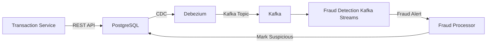
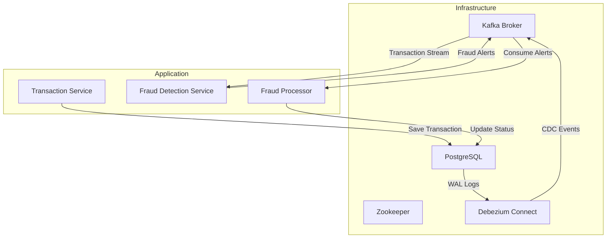

# Fraud Detection - Real-time Transaction Monitoring


### Профессиональная система для обнаружения мошеннических транзакций в реальном времени с использованием:

- Kafka Streams для обработки потоковых данных
- Debezium для CDC (Change Data Capture)
- PostgreSQL как основного хранилища данных
- Spring Boot как бэкенд-фреймворка

---
### Схема работы



---

> ### ⚠️ ВАЖНОЕ ПРИМЕЧАНИЕ ПО БЕЗОПАСНОСТИ
> **SSL/TLS сертификаты не включены в публичный репозиторий** в целях безопасности.  
> Для настройки защищенного соединения следуйте инструкциям в разделах:  
> [Конфигурация безопасности](#конфигурация-безопасности).

---


## Структура проекта

```
fraud-detection/
├── src/
│   ├── main/
│   │   ├── java/com/
│   │   │   ├── config/           # Конфигурация Kafka
│   │   │   ├── controller/       # REST контроллеры
│   │   │   ├── detection/        # Главный класс приложения
│   │   │   ├── model/            # Сущности данных
│   │   │   ├── repository/       # Репозитории Spring Data
│   │   │   └── service/          # Бизнес-логика и Kafka Streams
│   │   └── resources/
│   │       ├── ssl/              # SSL сертификаты (не включены в репозиторий)
│   │       ├── application.properties
│   │       └── logback-spring.xml
├── docker-compose.yml            # Docker инфраструктура
├── register-connector.sh         # Скрипт настройки Debezium
├── pom.xml                       # Maven зависимости
└── README.md                     # Документация
```

---

## Технологический стек

- Java 17
- Spring Boot 3.5.0
- Apache Kafka 3.5.1
- Kafka Streams
- Debezium 2.3
- PostgreSQL 13
- Docker 20.10+
- Maven 3.8+


### Архитектура решения


---
## Требования к окружению
Минимальные системные требования

- CPU: 4 ядра
- RAM: 8 GB
- Disk: 20 GB свободного пространства
- OS: Linux/macOS/Windows (с WSL2)

### Необходимое ПО
- Docker 20.10.0+
- Docker Compose 1.29.0+
- Java JDK 17+
- Maven 3.8+
- Git 2.30+

---
## Развертывание системы
1. Клонирование репозитория

```bash
git clone https://github.com/your-repo/fraud-detection-system.git
cd fraud-detection-system
```

2. Запуск инфраструктуры
```bash
docker-compose up -d
```

3. Регистрация Debezium Connector
```bash
chmod +x register-connector.sh
./register-connector.sh
```

4. Сборка и запуск приложения
```bash
mvn clean package
java -jar target/fraud-detection-1.0.0.jar
```

5. Проверка работоспособности
```bash
curl -X POST http://localhost:8080/transactions \
  -H "Content-Type: application/json" \
  -d '{"amount": 150.0, "currency": "USD", "userId": 123}'
``` 


### Добавление настроек SSL для Spring Boot приложение:

```
# application.properties
spring.kafka.properties.security.protocol=SSL
spring.kafka.ssl.trust-store-location=classpath:ssl/kafka.client.truststore.jks
spring.kafka.ssl.trust-store-password=changeit
```
---
## Тестирование системы
### 1. Генерация тестовых транзакций

```
# Генерируем 3 транзакции для одного пользователя
for i in {1..3}; do
  curl -X POST http://localhost:8080/transactions \
    -d "{\"amount\": $((100 * $i)), \"currency\": \"USD\", \"userId\": 1001}"
done
```
### 2. Мониторинг алертов

```bash
# Просмотр алертов в Kafka
docker exec -it kafka kafka-console-consumer \
  --bootstrap-server localhost:9093 \
  --topic fraud-alerts \
  --from-beginning  
```

### 3. Проверка статуса транзакций

```
# SQL
SELECT user_id, status, COUNT(*) 
FROM transaction 
GROUP BY user_id, status;
```
---
## Мониторинг и отладка
### Доступные интерфейсы:
- Debezium Connect: http://localhost:8083/connectors
- PostgreSQL: psql -h localhost -U springuser transactions_db

---
## Оптимизация производительности
### Настройки Kafka Streams
```
# application.properties
spring.kafka.streams.properties.num.stream.threads=4
spring.kafka.streams.properties.commit.interval.ms=1000
spring.kafka.streams.properties.cache.max.bytes.buffering=10485760
```

### Параметры Docker
```
# docker-compose.yml
kafka:
  environment:
    KAFKA_HEAP_OPTS: "-Xmx2G -Xms2G"
    KAFKA_JVM_PERFORMANCE_OPTS: "-XX:MetaspaceSize=96m"
```


---

## Конфигурация безопасности

### 1. Создайте SSL сертификаты в директории docker/ssl (в корне проекта):

```bash
# Генерация CA
openssl req -new -x509 -keyout ca.key -out ca.crt -days 365 -subj "/CN=Kafka-CA" -passout pass:changeit

# Генерация сертификата для Kafka
keytool -keystore kafka.jks -alias kafka -validity 365 -genkey -keyalg RSA -storepass changeit -keypass changeit -dname "CN=kafka"

# Создание CSR
keytool -keystore kafka.jks -alias kafka -certreq -file cert-file -storepass changeit

# Подпись сертификата
openssl x509 -req -CA ca.crt -CAkey ca.key -in cert-file -out cert-signed -days 365 -CAcreateserial -passin pass:changeit

# Импорт CA и сертификата в хранилище
keytool -keystore kafka.jks -alias CARoot -import -file ca.crt -storepass changeit -noprompt
keytool -keystore kafka.jks -alias kafka -import -file cert-signed -storepass changeit

# Создание truststore
keytool -keystore truststore.jks -alias CARoot -import -file ca.crt -storepass changeit -noprompt
```
---------------------------------------------------------
AI - CA_Kafka
настройки SSL/TLS в Apache Kafka. Этот процесс включает в себя создание собственного центра сертификации (CA) и выпуск подписанного сертификата для брокера Kafka.

1. Генерация CA (Центра Сертификации)

Команда создает ваш собственный доверенный удостоверяющий центр (Certificate Authority). Этот CA будет использоваться для подписи сертификатов серверов и клиентов.
openssl req -new -x509 -keyout ca.key -out ca.crt -days 365 -subj "/CN=Kafka-CA" -passout pass:changeit
• openssl req: Вызывает утилиту OpenSSL для работы с запросами на сертификаты и создания сертификатов X.509.
• -new: Генерирует новый запрос на сертификат.
• -x509: Указывает создать самоподписанный сертификат (вместо обычного запроса CSR). Это и делает данный сертификат Корневым CA.
• -keyout ca.key: Имя файла, в который запишется приватный ключ создаваемого CA. Его нужно держать в секрете.
• -out ca.crt: Имя файла для самого публичного сертификата CA. Его будут импортировать все участники сети для проверки подлинности друг друга.
• -days 365: Срок действия сертификата CA (1 год).
• -subj "/CN=Kafka-CA": Задает субъект сертификата. В данном случае Common Name (CN) равен Kafka-CA. Это имя будет отображаться в свойствах сертификата.
• -passout pass:changeit: Пароль для шифрования приватного ключа ca.key (пароль: changeit), чтобы его нельзя было украсть в открытом виде.

2. Генерация хранилища (Keystore) и ключа для Kafka

Команда создает хранилище ключей (Keystore) для брокера Kafka и генерирует в нем пару из приватного и публичного ключа.
keytool -keystore kafka.jks -alias kafka -validity 365 -genkey -keyalg RSA -storepass changeit -keypass changeit -dname "CN=kafka"
• keytool: Утилита из состава Java SDK для управления ключами и сертификатами.
• -keystore kafka.jks: Имя файла хранилища (Java Keystore), где будет лежать приватный ключ брокера. Если файла нет, он создастся.
• -alias kafka: Уникальное имя (псевдоним) внутри хранилища для этой конкретной связки ключей.
• -validity 365: Срок действия генерируемого ключа (365 дней).
• -genkey: Флаг (или -genkeypair), указывающий на генерацию пары ключей (открытый/закрытый).
• -keyalg RSA: Алгоритм шифрования (в данном случае RSA).
• -storepass changeit: Пароль для доступа к самому файлу хранилища kafka.jks.
• -keypass changeit: Пароль для доступа конкретно к приватному ключу под алиасом kafka (для Kafka часто требуется, чтобы пароль хранилища и ключа совпадали).
• -dname "CN=kafka": Distinguished Name. Имя субъекта. Для Kafka критически важно, чтобы CN совпадал с FQDN (доменным именем) хоста, на котором запущен брокер, иначе клиенты могут выдать ошибку проверки имени (хотя это можно отключить в конфигах).

3. Создание CSR (Запроса на подпись сертификата)

Поскольку созданный в пункте 2 ключ является самоподписанным, Kafka не сможет использовать его в доверенной среде. Нужно извлечь публичный ключ и создать запрос на его подпись у CA.
keytool -keystore kafka.jks -alias kafka -certreq -file cert-file -storepass changeit
• -certreq: Команда на генерацию Certificate Signing Request (CSR).
• -file cert-file: Имя создаваемого файла запроса (содержит публичный ключ и информацию о хосте из Keystore).
• Все остальные параметры (-keystore, -alias, -storepass) указывают утилите, из какого хранилища и под каким именем брать исходный ключ для создания запроса.

4. Подпись сертификата с помощью CA

Эта команда берет созданный запрос cert-file и подписывает его с помощью приватного ключа вашего CA.
openssl x509 -req -CA ca.crt -CAkey ca.key -in cert-file -out cert-signed -days 365 -CAcreateserial -passin pass:changeit
• openssl x509: Использование утилиты OpenSSL для работы с сертификатами X.509.
• -req: Указывает, что на вход подается запрос (CSR), а не готовый сертификат.
• -CA ca.crt и -CAkey ca.key: Публичный сертификат и приватный ключ вашего CA, которым подписывается запрос.
• -in cert-file: Входной файл запроса, созданный на шаге 3.
• -out cert-signed: Имя итогового файла — это подписанный, готовый к работе сертификат брокера Kafka.
• -CAcreateserial: Создает файл с серийным номером (если его нет), который OpenSSL использует для присвоения уникального номера каждому подписанному сертификату.
• -passin pass:changeit: Пароль для разблокировки приватного ключа ca.key (который мы задали на шаге 1).

5. Импорт CA и подписанного сертификата в Keystore

Чтобы брокер Kafka мог использовать подписанный сертификат, внутри его kafka.jks должна быть выстроена «цепочка доверия». Для этого сначала импортируют корневой сертификат CA, а затем сам подписанный сертификат брокера.
Команда А (Импорт CA):
keytool -keystore kafka.jks -alias CARoot -import -file ca.crt -storepass changeit -noprompt
• -import: Режим импорта сертификата в хранилище.
• -alias CARoot: Алиас, под которым корневой сертификат CA сохранится в хранилище.
• -file ca.crt: Файл корневого сертификата (из шага 1).
• -noprompt: Автоматически соглашаться на импорт, не спрашивая у пользователя интерактивного подтверждения "Доверяете ли вы этому сертификату?".
Команда Б (Импорт подписанного сертификата брокера):
keytool -keystore kafka.jks -alias kafka -import -file cert-signed -storepass changeit
• Здесь мы импортируем файл cert-signed под тем же самым алиасом kafka, под которым изначально создавали ключи на шаге 2. keytool поймет, что этот подписанный сертификат соответствует приватному ключу внутри хранилища, и обновит его, связав их в единую цепочку.

6. Создание Truststore (Хранилища доверия)

Брокеру Kafka (и его клиентам) нужно знать, кому из внешних подключений можно доверять. Truststore хранит только публичные сертификаты тех CA, которым узел доверяет.
keytool -keystore truststore.jks -alias CARoot -import -file ca.crt -storepass changeit -noprompt
• -keystore truststore.jks: Создается совершенно новый файл хранилища — truststore.jks. В отличие от keystore.jks, здесь нет приватных ключей брокера, только публичные сертификаты.
• -import -file ca.crt: Мы добавляем наш корневой сертификат CA в это хранилище под алиасом CARoot.
• Теперь любой клиент или брокер, чей сертификат подписан этим ca.crt, будет считаться доверенным для системы, использующей данный truststore.jks.

---------------------------------------------------------


### 2. Обновите конфигурацию Docker:

```bash
# docker-compose.yml
kafka:
  environment:
    KAFKA_LISTENER_SECURITY_PROTOCOL_MAP: INTERNAL:SSL, EXTERNAL:SSL
    KAFKA_SSL_KEYSTORE_FILENAME: kafka.server.keystore.jks
    KAFKA_SSL_KEYSTORE_CREDENTIALS: ssl_creds
    KAFKA_SSL_KEY_CREDENTIALS: ssl_creds
  volumes:
    - ./ssl:/etc/kafka/secrets
```

### 3. Настройте Spring Boot приложение:
```bash
# application.properties
spring.kafka.properties.security.protocol=SSL
spring.kafka.ssl.trust-store-location=classpath:ssl/kafka.client.truststore.jks
spring.kafka.ssl.trust-store-password=changeit
```


### Запуск приложения

```bash
# Запуск контейнеров
docker-compose up -d

# Запускаем скрипт в bash 
./register-connector.sh

# Далее запускаем Spring Boot приложение в классе FraudDetectionApplication

# Удаление контейнеров
docker-compose down -v --remove-orphans
```

### Если необходима полная перезагрузка:

```bash
docker-compose down -v --remove-orphans
docker system prune -a -f
docker-compose up -d
````

---
## Тестирование работы:

 - Отправка тестовых транзакций
 ```bash
curl -X POST http://localhost:8080/transactions -H "Content-Type: application/json" -d '{
"amount": 1500.00,
"currency": "USD",
"userId": 12345
}'

# Проверка логов Kafka Streams
docker-compose logs kafka | grep "Fraud detected"
 ```

### Подключится напрямую к контейнеру:

```bash
docker exec -it postgres psql -U postgres -d transactions_db
```
---
## Оптимизация производительности
### Настройки Kafka Streams

```
# application.properties
spring.kafka.streams.properties.num.stream.threads=4
spring.kafka.streams.properties.commit.interval.ms=1000
spring.kafka.streams.properties.cache.max.bytes.buffering=10485760
```

### Параметры Docker
```
# docker-compose.yml
kafka:
  environment:
    KAFKA_HEAP_OPTS: "-Xmx2G -Xms2G"
    KAFKA_JVM_PERFORMANCE_OPTS: "-XX:MetaspaceSize=96m"
```
---
## 📜 Лицензия
© 2025. Данный проект распространяется под лицензией [MIT License](https://choosealicense.com/licenses/mit/).

ERROs
#spring.kafka.ssl.trust-store-location=file:${user.dir}/docker/ssl/kafka.server.truststore.jks
#spring.kafka.ssl.key-store-location=file:${user.dir}/docker/ssl/kafka.server.keystore.jks
spring.kafka.ssl.trust-store-location=classpath:ssl/truststore.jks  (as more preferred)
